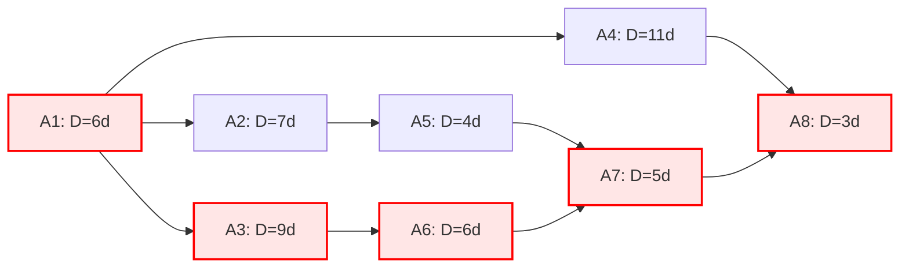

# Manuelle Netzplanrechnung (Aufgabe 5.1)

## 1. Vervollständigte Termintabelle

| Aktivität | FB - 9 Uhr | FE - 9 Uhr | SB - 18 Uhr | SE - 18 Uhr | D [Tage] | GP      | Vorgänger |
| :-------- | :--------- | :--------- | :---------- | :---------- | :------- | :------ | :-------- |
| **A1**    | Fr, 02.06. | Fr, 09.06. | Fr, 02.06.  | Fr, 09.06.  | 6        | 0 Tage  | -         |
| **A2**    | Mo, 12.06. | Di, 20.06. | Mo, 19.06.  | Di, 27.06.  | 7        | 5 Tage  | A1        |
| **A3**    | Mo, 12.06. | Do, 22.06. | Mo, 12.06.  | Do, 22.06.  | 9        | 0 Tage  | A1        |
| **A4**    | Mo, 12.06. | Mo, 26.06. | Di, 27.06.  | Di, 11.07.  | 11       | 11 Tage | A1        |
| **A5**    | Mi, 21.06. | Mo, 26.06. | Mi, 28.06.  | Mo, 03.07.  | 4        | 5 Tage  | A2        |
| **A6**    | Fr, 23.06. | Fr, 30.06. | Fr, 23.06.  | Fr, 30.06.  | 6        | 0 Tage  | A3        |
| **A7**    | Mo, 03.07. | Fr, 07.07. | Mo, 03.07.  | Fr, 07.07.  | 5        | 0 Tage  | A5, A6    |
| **A8**    | Mo, 10.07. | Mi, 12.07. | Mo, 10.07.  | Mi, 12.07.  | 3        | 0 Tage  | A4, A7    |

---

## 2. Netzplan-Graph (Struktur)

## 3. Kritischer Pfad & Gesamtdauer

- **Kritischer Pfad:** `A1 -> A3 -> A6 -> A7 -> A8`
    
- **Gesamtdauer:** $6 + 9 + 6 + 5 + 3 = 29 \text{ Arbeitstage}$
    
- **Projektende:** Mittwoch, 12.07.
    

## 4. Risikoanalyse: Reduktion der Dauer von A3 auf 5 PT

- **Änderung im Netzplan:**
    
    - Die Pfaddauer des bisherigen kritischen Pfads (`A1 -> A3 -> A6 -> A7 -> A8`) sinkt von 29 Tage auf $6 + 5 + 6 + 5 + 3 = 25 \text{ Arbeitstage}$.
        
    - Der Pfad über A2 (`A1 -> A2 -> A5 -> A7 -> A8`) benötigt $6 + 7 + 4 + 5 + 3 = 25 \text{ Arbeitstage}$.
        
- **Konsequenzen für den Projektendtermin:**
    
    - Der Projektendtermin verkürzt sich um **4 Tage** auf **25 Arbeitstage** (neues Ende: Donnerstag, 06.07.).
        
    - Ab dieser Reduktion entstehen **zwei parallele kritische Pfade**:
        
        1. `A1 -> A3 -> A6 -> A7 -> A8`
            
        2. `A1 -> A2 -> A5 -> A7 -> A8`