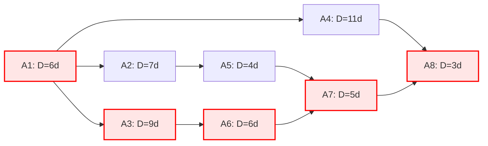

# Manuelle Netzplanrechnung (Aufgabe 5.1)

## 1. Vervollständigte Termintabelle

| Aktivität | Dauer (D) [PT] | Vorgänger | Frühester Beginn (FB) | Frühestes Ende (FE) | Spätester Beginn (SB) | Spätestes Ende (SE) | Gesamte Pufferzeit (GP) |
| :--- | :--- | :--- | :--- | :--- | :--- | :--- | :--- |
| **A1** | 6 | - | Fr, 02.06. | Fr, 09.06. | Fr, 02.06. | Fr, 09.06. | 0 Tage |
| **A2** | 7 | A1 | Mo, 12.06. | Di, 20.06. | Mo, 19.06. | Di, 27.06. | 5 Tage |
| **A3** | 9 | A1 | Mo, 12.06. | Do, 22.06. | Mo, 12.06. | Do, 22.06. | 0 Tage |
| **A4** | 11 | A1 | Mo, 12.06. | Mo, 26.06. | Di, 27.06. | Bi, 11.07. | 11 Tage |
| **A5** | 4 | A2 | Mi, 21.06. | Mo, 26.06. | Mi, 28.06. | Mo, 03.07. | 5 Tage |
| **A6** | 6 | A3 | Fr, 23.06. | Fr, 30.06. | Fr, 23.06. | Fr, 30.06. | 0 Tage |
| **A7** | 5 | A5, A6 | Mo, 03.07. | Fr, 07.07. | Mo, 03.07. | Fr, 07.07. | 0 Tage |
| **A8** | 3 | A4, A7 | Mo, 10.07. | Mi, 12.07. | Mo, 10.07. | Mi, 12.07. | 0 Tage |

---

## 2. Netzplan-Graph (Struktur)

## 3. Kritischer Pfad & Gesamtdauer

- **Kritischer Pfad:** `A1 -> A3 -> A6 -> A7 -> A8`
    
- **Gesamtdauer:** $6 + 9 + 6 + 5 + 3 = 29 \text{ Arbeitstage}$
    
- **Projektende:** Mittwoch, 12.07.
    

## 4. Risikoanalyse: Reduktion der Dauer von A3 auf 5 PT

- **Änderung im Netzplan:**
    
    - Die Pfaddauer des bisherigen kritischen Pfads (`A1 -> A3 -> A6 -> A7 -> A8`) sinkt von 29 Tage auf $6 + 5 + 6 + 5 + 3 = 25 \text{ Arbeitstage}$.
        
    - Der Pfad über A2 (`A1 -> A2 -> A5 -> A7 -> A8`) benötigt $6 + 7 + 4 + 5 + 3 = 25 \text{ Arbeitstage}$.
        
- **Konsequenzen für den Projektendtermin:**
    
    - Der Projektendtermin verkürzt sich um **4 Tage** auf **25 Arbeitstage** (neues Ende: Donnerstag, 06.07.).
        
    - Ab dieser Reduktion entstehen **zwei parallele kritische Pfade**:
        
        1. `A1 -> A3 -> A6 -> A7 -> A8`
            
        2. `A1 -> A2 -> A5 -> A7 -> A8`