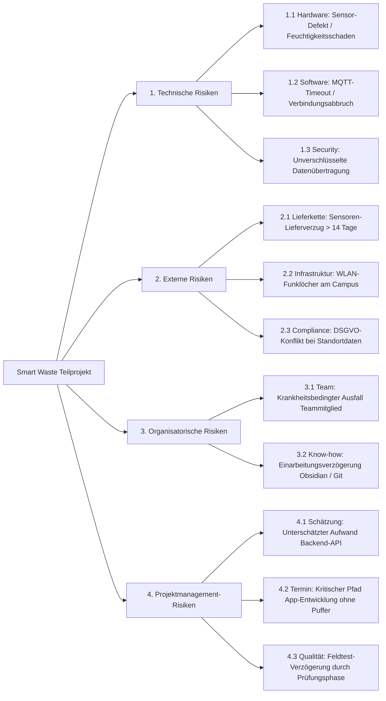

# Risk Breakdown Structure (RBS) - Smart Waste

## Risiko-Strukturbaum

---

## Übersicht der Risikokategorien

| ID | Kategorie | Beschreibung |
| :--- | :--- | :--- |
| **1.x** | **Technische Risiken** | Risiken bezüglich Sensorik, Hardware-Korrosion, API-Schnittstellen und Datensicherheit. |
| **2.x** | **Externe Risiken** | Lieferverzögerungen von Bauteilen, WLAN-Abdeckung der Hochschule und rechtliche Vorgaben. |
| **3.x** | **Organisatorische Risiken** | Personalausfälle im Team 08 sowie Einarbeitung in benötigte Software-Tools. |
| **4.x** | **PM-Risiken** | Fehleinschätzungen bei Aufwänden, Pufferknappheit auf dem kritischen Pfad und Terminkonflikte. |